# Senkron Makine Sürücüsünde Derin Öğrenme Tabanlı Tork Kontrolü ve Kestirimci Bakım


Bu çalışma, MathWorks Simscape Electrical kütüphanesinde yer alan **[Synchronous Machine Torque Control](https://www.mathworks.com/help/simscape-electrical/ug/sm-torque-control.html)** referans modeli temel alınarak geliştirilmiştir. Orijinal modeldeki klasik kontrol yapısı (3-boyutlu Lookup Table ve PI kontrolcüler), iki aşamalı bir mühendislik çalışmasıyla önce tamamen derin sinir ağları tabanlı bir kontrol mimarisine dönüştürülmüş, ardından sistem üzerine fiziksel arıza enjeksiyon blokları eklenerek kestirimci bakım (Predictive Maintenance) ve arıza teşhis yapısı kurulmuştur.

Proje iki ana bölümden oluşmaktadır:

1. **Bölüm 1 — Derin Öğrenme Tabanlı Kaskad Tork ve Akım Kontrolü (`Bolum1_YapayZeka_TorkKontrolu/`):**  
   Orijinal modelde dış döngüde kullanılan 3-boyutlu Lookup Table blokları ve iç döngüdeki 3 adet PI kontrolcü tamamen kaldırılmıştır. Yerlerine dış döngüde fizik-destekli karar ağı (`DNN-1`), iç döngüde ise PI bloklarına ihtiyaç duymayan çok girişli çok çıkışlı (MIMO) akım kontrol ağı (`DNN-2`) yerleştirilmiştir. Çıkık kutuplu senkron makinedeki relüktans tork kaybı ($(L_d - L_q) i_d i_q$) telafi edilerek ortalama mutlak tork takip hatası (MAE) **%91.61 oranında düşürülmüştür** (`40.42 Nm` seviyesinden `3.39 Nm` seviyesine).
2. **Bölüm 2 — Fiziksel Arıza Enjeksiyonu ve Kestirimci Bakım (`Bolum2_KestirimciBakim_ArizaTeshisi/`):**  
   Yapay zeka kontrolcülü sürücü modeli üzerine **DC-Bara Kapasitör Yaşlanması**, **Stator Sargı/İzolasyon Arızası** ve **İnverter IGBT Açık Devre Arızası** ile sahada karşılaşılan **6 farklı bozucu etken** (Hall-effect sensör DC ofset kayması, faz kalibrasyon hatası, %125 aşırı yük darbeleri, rejeneratif bara çökmeleri, renkli ölçüm gürültüsü ve farklı arıza şiddetleri) fiziksel olarak modellenmiştir. **Classification Learner** üzerinde eğitilen 35 farklı model arasında **%97.50 (`468 / 480` doğru — Wide Neural Network)** çapraz doğrulama başarımı elde edilmiştir. Simulink modelinin üst kısmına eklenen **5 adet etkileşimli arıza seçim butonu** ile simülasyon esnasında çalışma modları canlı olarak değiştirilebilmektedir.

---

## Sistem Mimarisi ve İş Akışı

### 1. Bölüm 1: Derin Öğrenme Kaskad Kontrol Mimarisi (`SMTorqueControl_AI.slx`)

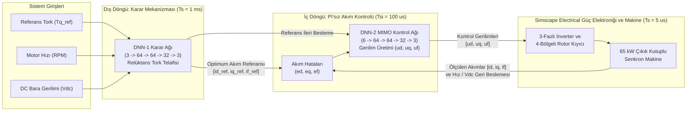

### 2. Bölüm 2: 4-Sınıflı Kestirimci Bakım ve Sınıflandırma Hattı (`SMTorqueControl_PdM.slx`)

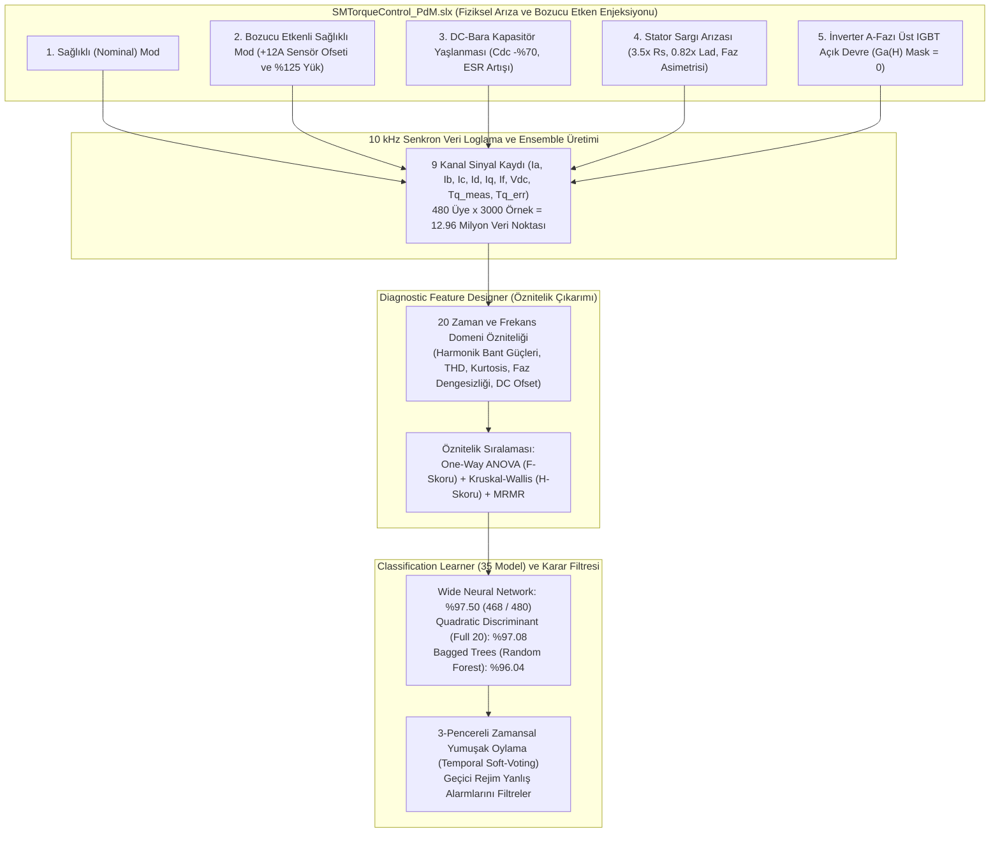

---

## Klasör Yapısı

Her bölüm kendi alt klasöründe bağımsız çalışabilecek şekilde düzenlenmiştir. Kök dizindeki `startup.m` betiği çalıştırıldığında tüm alt klasörler otomatik olarak MATLAB yoluna (`path`) eklenir:

```text
SMTorqueControlExample/
├── README.md                                              # Proje dokümantasyonu
├── startup.m                                              # Tüm yolları (Path) ve tabloları yükleyen başlatıcı betik
├── Arayuzler_Icin_Hizli_Baslatici.mlx                     # DFD, Classification Learner ve Deep Network Designer başlatıcı
├── LICENSE                                                # MIT Lisansı
├── .gitignore                                             # MATLAB/Simulink geçici dosya ve büyük veri filtreleri
│
├── Ortak_Veri_ve_Parametreler/                            # Her iki bölümün kullandığı ortak makine ve referans verileri
│   ├── SMTorqueControlData.m                              # 65 kW Senkron Makine, batarya ve kontrol parametreleri
│   ├── SM65kWCurrentReferences.mat                        # 3-Boyutlu klasik akım referans haritaları (7x101x6)
│   ├── SMTorqueControlLoadRPM.mat                         # Senkron makine hız (RPM) profili zaman serisi
│   └── SMTorqueControlTorqueRequest.mat                   # Referans tork basamakları (Motor ve Jeneratör rejimi)
│
├── Bolum1_YapayZeka_TorkKontrolu/                         # BÖLÜM 1: Derin Öğrenme (DNN-1 + DNN-2) Tork Kontrolü
│   ├── YapayZeka_TorkKontrolu_AdimAdim_Rehber.mlx         # Adım adım MATLAB Live Script rehberi
│   ├── YapayZeka_TorkKontrolu_AdimAdim_Rehber.html        # Tarayıcıda görüntülenebilir HTML çıktısı
│   ├── SMTorqueControl.slx                                # Orijinal klasik model (3B Lookup Table + 3x PI Kontrolcü)
│   ├── SMTorqueControl_AI.slx                             # Derin öğrenme modeli (DNN-1 Karar Ağı + DNN-2 Akım Kontrol Ağı)
│   ├── Mat_Dosyalari/                                     # Bölüm 1 eğitilmiş ağ ağırlıkları ve simülasyon sonuçları
│   │   ├── DNN1_DecisionNet.mat                           # Dış döngü karar ağı (dlnetwork, 29 KB)
│   │   ├── DNN2_ControllerNet.mat                         # İç döngü PI'sız MIMO kontrol ağı (dlnetwork, 30 KB)
│   │   ├── DNN2_Training_Data.mat                         # İç döngü durum uzayı eğitim verisi (493 KB)
│   │   ├── Classic_Baseline_Results.mat                   # Klasik model 1.0 s simülasyon sonuçları (868 KB)
│   │   └── AI_Simulation_Results.mat                      # AI model 1.0 s simülasyon sonuçları (5.66 MB)
│   └── Gorseller/                                         # Bölüm 1 Simulink şemaları ve doğrulama grafikleri (12 PNG)
│
└── Bolum2_KestirimciBakim_ArizaTeshisi/                   # BÖLÜM 2: 4-Sınıflı Kestirimci Bakım ve Arıza Teşhisi (PdM)
    ├── KestirimciBakim_ArizaTeshisi_AdimAdim_Rehber.mlx   # Adım adım Kestirimci Bakım Live Script rehberi
    ├── KestirimciBakim_ArizaTeshisi_AdimAdim_Rehber.html  # Tarayıcıda görüntülenebilir HTML çıktısı
    ├── Arayuzler_Icin_Hizli_Baslatici.mlx                 # Canlı demo arayüzlerini (35 Model hazır) açan başlatıcı
    ├── SMTorqueControl_PdM.slx                            # 5 canlı arıza seçim butonlu PdM Simulink modeli
    ├── Mat_Dosyalari/                                     # Bölüm 2 arıza veri kümeleri, öznitelik tabloları ve sınıflandırıcılar
    │   ├── PdM_4Class_RawWaveforms.mat                    # 4 arıza sınıfı + bozucu etkenli dalga formları (2.42 MB)
    │   ├── PdM_ClassificationLearner_Oturumu.mat          # Classification Learner 35-Model hazır oturumu (4.02 MB)
    │   ├── PdM_Trained_Classifier.mat                     # Eğitilmiş Random Forest, Multi-SVM ve öznitelik tabloları (740 KB)
    │   ├── PdM_ClassificationLearner_Full20_Oturumu.mat   # [LFS/Harici] Tüm 20 öznitelikli 35-Model CL oturumu (40.9 MB)
    │   ├── PdM_Diagnostic_Ensemble.mat                    # [LFS/Harici] 480 üyeli (12.96M noktalı) ham timetable kümesi (56.4 MB)
    │   └── PdM_DFD_Oturumu.mldatx                         # [LFS/Harici] Kaydedilmiş Diagnostic Feature Designer oturumu (186.6 MB)
    └── Gorseller/                                         # Bölüm 2 Simulink arıza blokları, PSD, DFD ve teşhis grafikleri (11 PNG)
```

---

## Kurulum ve Çalıştırma

### 1. Projeyi Başlatma
Projeyi klonladıktan sonra MATLAB'da proje kök dizinine gelip aşağıdaki komutu çalıştırın:

```matlab
startup
```

`startup.m` çalıştırıldığında:
- `Ortak_Veri_ve_Parametreler`, `Bolum1_YapayZeka_TorkKontrolu` ve `Bolum2_KestirimciBakim_ArizaTeshisi` alt klasörlerini MATLAB yoluna (`path`) ekler,
- 65 kW senkron makine parametrelerini ve kestirimci bakım öznitelik tablolarını (`PdM_ClassificationLearner_Top12Table` vb.) çalışma uzayına (`Base Workspace`) yükler,
- Komut penceresinde `.mlx` rehberlerini ve `.slx` modellerini doğrudan açabileceğiniz bağlantıları listeler.

> [!TIP]
> `startup.m` çalıştırılmadan doğrudan `Bolum1_YapayZeka_TorkKontrolu/` veya `Bolum2_KestirimciBakim_ArizaTeshisi/` içerisindeki bir `.mlx` veya `.slx` dosyası açıldığında da modellerin `PreLoadFcn` / `InitFcn` geri çağırma fonksiyonları ortak parametre klasörünü otomatik olarak yola ekler.

### 2. Rehber Dosyalarını ve Arayüzleri Açma

```matlab
% Canlı Demo Arayüz Başlatıcısı (DFD + Classification Learner 35 Model + Deep Network Designer)
edit('Arayuzler_Icin_Hizli_Baslatici.mlx')

% Bölüm 1: Derin Öğrenme Tork Kontrolü Rehberi
edit('YapayZeka_TorkKontrolu_AdimAdim_Rehber.mlx')

% Bölüm 2: Kestirimci Bakım ve Arıza Teşhisi Rehberi
edit('KestirimciBakim_ArizaTeshisi_AdimAdim_Rehber.mlx')

% Eğitilmiş 35 modeli içeren Classification Learner oturumunu doğrudan açma:
classificationLearner(which('PdM_ClassificationLearner_Oturumu.mat'))
```

> [!NOTE]
> **Büyük Dosyalar Hakkında:**  
> GitHub dosya boyutu sınırları nedeniyle `PdM_DFD_Oturumu.mldatx` (`186.6 MB`), `PdM_Diagnostic_Ensemble.mat` (`56.4 MB`) ve `PdM_ClassificationLearner_Full20_Oturumu.mat` (`40.9 MB`) `.gitignore` dosyasına eklenmiştir. Bununla birlikte **eğitilmiş derin ağlar (`DNN1`, `DNN2`), 35 modelin tamamını içeren `PdM_ClassificationLearner_Oturumu.mat` (`4.02 MB`), sınıflandırıcı modeller (`Mdl_RandomForest`, `Mdl_MultiSVM`) ve 480 üyeli öznitelik tabloları (`PdM_Feature_Table`, `PdM_ClassificationLearner_Top12Table`, `Feature_Ranking_Table`) doğrudan depoda yer almaktadır.** Depoyu klonlayan kullanıcılar ek bir dosyaya ihtiyaç duymadan tüm `.mlx` rehberlerini, `.slx` modellerini ve `Classification Learner` oturumunu çalıştırabilir.

---

## Bölüm 1: Derin Öğrenme Tabanlı Tork ve Akım Kontrolü (`Bolum1_YapayZeka_TorkKontrolu/`)

### 1.1. Çıkık Kutuplu Senkron Makinede Relüktans Tork Kaybı
65 kW çıkık kutuplu senkron makinede d-ekseni senkron endüktansı ($L_d = 1.05\ \mathrm{pu}$), q-ekseni endüktansından ($L_q = 0.70\ \mathrm{pu}$) büyüktür. Elektromanyetik tork ifadesi:

$$T_e = \left(i_f + (L_d - L_q)\,i_d\right) i_q$$

Orijinal referans modeldeki (`SMTorqueControl.slx`) 3-boyutlu Lookup Table blokları, alan zayıflatma bölgesindeki negatif $i_d$ akımının neden olduğu relüktans tork bileşenini ($(L_d - L_q)i_d i_q$) telafi etmediği için yüksek tork basamaklarında **53.19 Nm kalıcı tork sapması** oluşmaktadır.

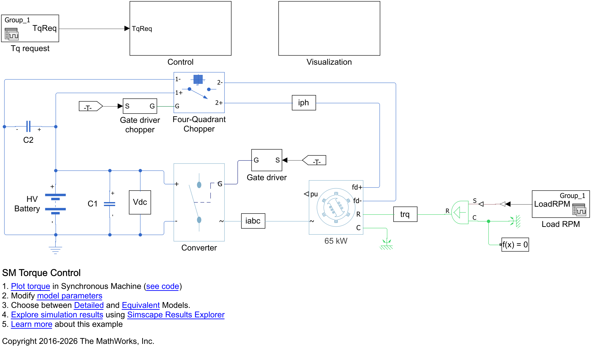

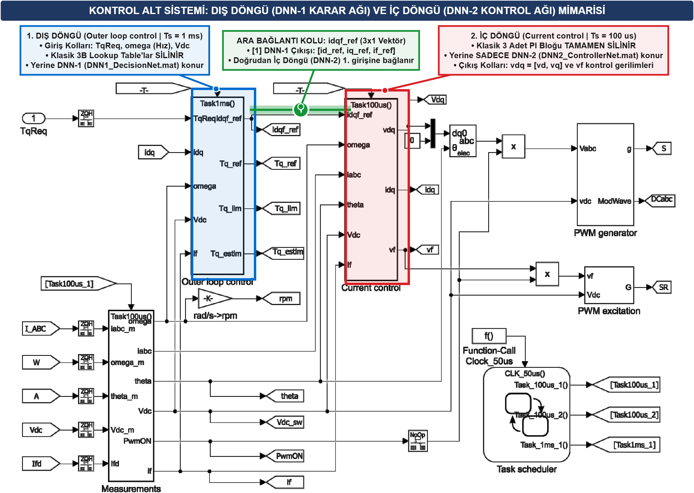

### 1.2. Dış Döngü: 3B Lookup Table Yerine Fizik-Destekli `DNN-1` Karar Ağı
Klasik dış döngüdeki 3 adet 3-Boyutlu Lookup Table bloğu kaldırılarak, motorun $7 \times 101 \times 6 = 4242$ çalışma noktasında relüktans tork denklemini sağlayan fizik-destekli akım referanslarıyla eğitilen **`DNN-1` (`3 -> 64 -> 64 -> 32 -> 3`)** derin sinir ağı yerleştirilmiştir:

| Dış Döngü (ÖNCE — Klasik 3B Lookup Table) | Dış Döngü (SONRA — `DNN1_Karar_Agi`) |
| :---: | :---: |
| 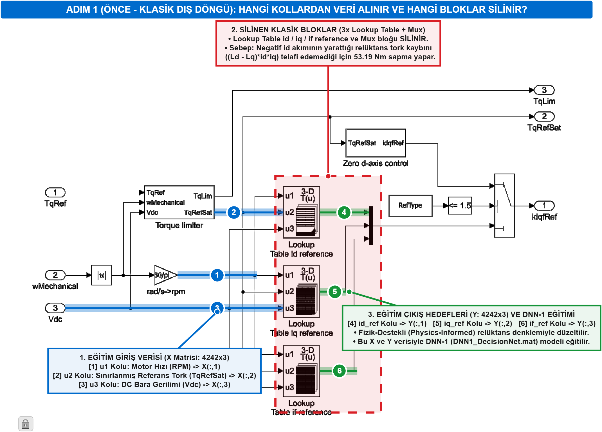 | 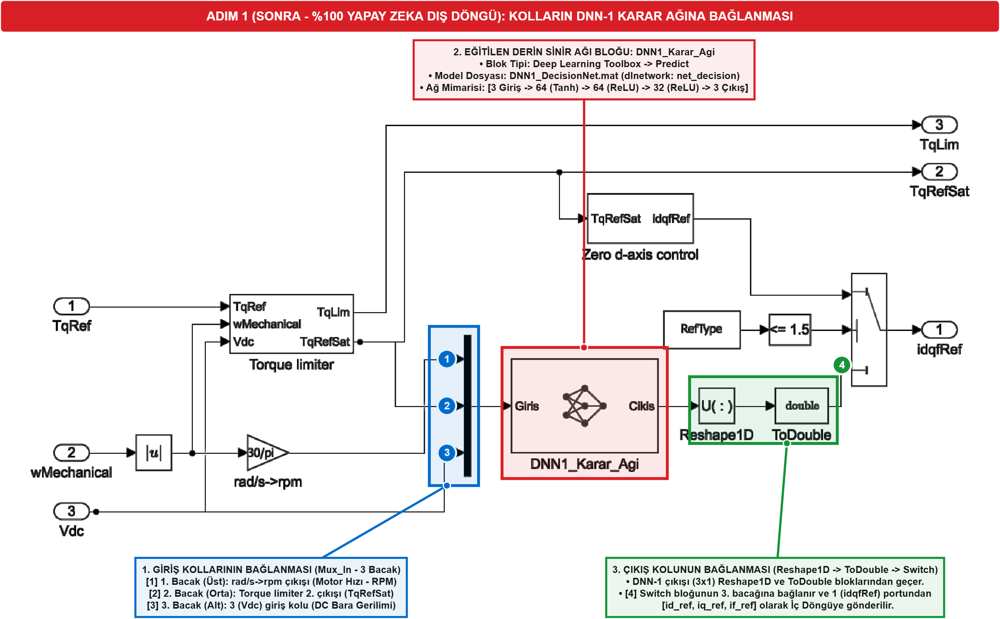 |

| 3B Optimum Akım Haritaları | `DNN-1` Doğrulama Başarımı ($R^2 > 0.999$) |
| :---: | :---: |
|  |  |

### 1.3. İç Döngü: 3x PI Kontrolcü Yerine PI'sız MIMO `DNN-2` Kontrol Ağı
İç döngüdeki (`SM Current Controller`) `PI id`, `Pi iq`, `Pi if` kontrolcüleri ve anti-windup geri besleme blokları kaldırılmış; 3 eksen akım hatası ($e_d, e_q, e_f$) ile 3 eksen referans akımını ($i_{d,\mathrm{ref}}, i_{q,\mathrm{ref}}, i_{f,\mathrm{ref}}$) alıp doğrudan kontrol gerilimlerini ($u_d, u_q, u_f$) üreten **`DNN-2` (`6 -> 64 -> 64 -> 32 -> 3`)** MIMO kontrol ağı bağlanmıştır:

| İç Döngü (ÖNCE — 3 Adet Klasik PI Kontrolcü) | İç Döngü (SONRA — PI'sız `DNN2_Akilli_Kontrol_Agi`) |
| :---: | :---: |
|  |  |

| `DNN-2` Durum Uzayı Eğitim Verisi | `DNN-2` Gerilim Tahmin Doğrulaması |
| :---: | :---: |
|  | 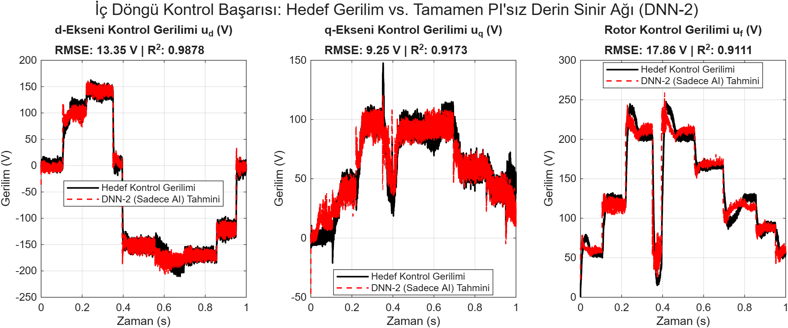 |

### 1.4. Kapalı-Çevrim Performans Karşılaştırması

| Kontrol Mimarisi | Dış Döngü ($T_s = 1\ \mathrm{ms}$) | İç Döngü ($T_{si} = 100\ \mu\mathrm{s}$) | RMSE Tork Sapması (Nm) | MAE Tork Sapması (Nm) | Hata Azaltımı (%) |
| :--- | :--- | :--- | :---: | :---: | :---: |
| **Klasik Kontrol (`SMTorqueControl.slx`)** | 3x 3B Lookup Table | 3x PI Kontrolcü + Anti-Windup | `46.51 Nm` | `40.42 Nm` | Referans |
| **Derin Öğrenme (`SMTorqueControl_AI.slx`)** | **DNN-1 Karar Ağı** | **DNN-2 MIMO Kontrol Ağı (PI'sız)** | **`6.54 Nm`** | **`3.39 Nm`** | **%91.61 İyileşme** |

| 1.0 Saniyelik Kapalı-Çevrim Tork Takibi ve Sapma Analizi | Hata Metrikleri Karşılaştırması (RMSE ve MAE) |
| :---: | :---: |
| 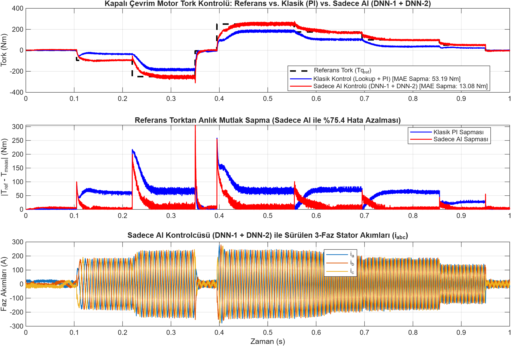 | 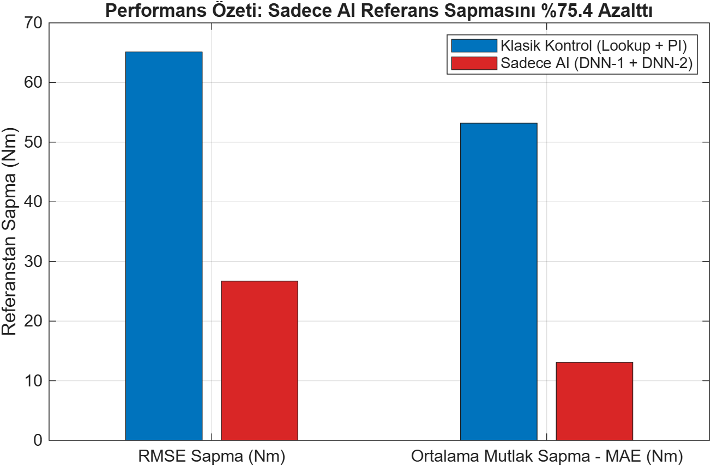 |

---

## Bölüm 2: 4-Sınıflı Kestirimci Bakım ve Arıza Teşhisi (`Bolum2_KestirimciBakim_ArizaTeshisi/`)

### 2.1. Simulink Üzerinde Canlı Arıza Seçim Butonları (`SMTorqueControl_PdM.slx`)
`SMTorqueControl_PdM.slx` modelinin üst kısmına, simülasyon başlamadan önce veya simülasyon çalışırken çift tıklanarak arıza/bozucu modunu değiştirmeyi sağlayan **5 adet etkileşimli buton** ve **1 adet Aktif Mod Göstergesi** eklenmiştir:


| Simulink Butonu | Arıza / Çalışma Sınıfı | Atanan Fiziksel Parametreler | Fiziksel Etki ve Sinyal İmzası |
| :--- | :--- | :--- | :--- |
| **1. SAĞLIKLI MOD** | `Healthy` (Nominal) | `Cdc_PdM = 1 mF`, `ESR = 0.1 mOhm`, `Rs_PdM = Rs`, `Gate_Mask = [1;1;1;1;1;1]` | Dengeli 3-faz stator akımı, sabit $350\ \mathrm{V}$ DC-bara, sıfır faz asimetrisi |
| **2. BOZUCU ETKENLİ** | `Healthy` (+Ağır Bozucu) | `Sensor_Offset = [+12;-6;-6] A`, `Unbalance = [1.04;0.98;0.98]`, `Load = 1.25x` | Hall-effect sensör DC sıfır kayması ve %125 aşırı yük darbesi altında sağlam sistem testi |
| **3. KAPASİTÖR ARIZASI** | `Capacitor_Aging` | `Cdc_PdM = 0.30*Cdc`, `ESR_PdM = 0.08 Ohm`, `Rbat_PdM = 0.18 Ohm` | Tork basamaklarında yüksek $V_{dc}$ dalgalanması (`129.6 V` p-p) ve $10\text{--}500\ \mathrm{Hz}$ bant gücü artışı |
| **4. STATOR SARGI ARIZASI** | `Stator_Winding_Fault` | `Rs_PdM = 3.5*Rs`, `Lad_PdM = 0.82*Lad`, `Unbalance = [1.12;0.94;0.94]` | Fazlar arası `%17.5` akım dengesizliği, $2\times f_e$ negatif bileşen salınımı ve tork düşümü |
| **5. IGBT AÇIK DEVRE** | `Inverter_IGBT_Fault` | `Gate_Fault_Mask = [0;1;1;1;1;1]` (A-Fazı Üst IGBT `Ga(H)` kesik) | $I_a$ pozitif alternans çökmesi (`-33.2 A` DC kayma), `%30.8` faz dengesizliği ve $1\times f_e$ harmonik tepe |

### 2.2. Fiziksel Arıza Enjektörü ve 10 kHz Sabit Adımlı Veri Loglama Alt Sistemleri

| İnverter IGBT Açık Devre Kapı Maskeleme Alt Sistemi | Stator Faz Asimetrisi, Sensör Bozucu Ofset ve 10 kHz Veri Loglama |
| :---: | :---: |
|  |  |

### 2.3. 4 Arıza Sınıfının Kapalı-Çevrim Dalga Formları ve Frekans Spektrumu (PSD)

| 4 Sınıf + Bozucu Etkenli Rejim Ham Dalga Formları | d-Ekseni Akımı ($I_d$) ve DC-Bara ($V_{dc}$) Güç Spektral Yoğunluğu (PSD) |
| :---: | :---: |
| 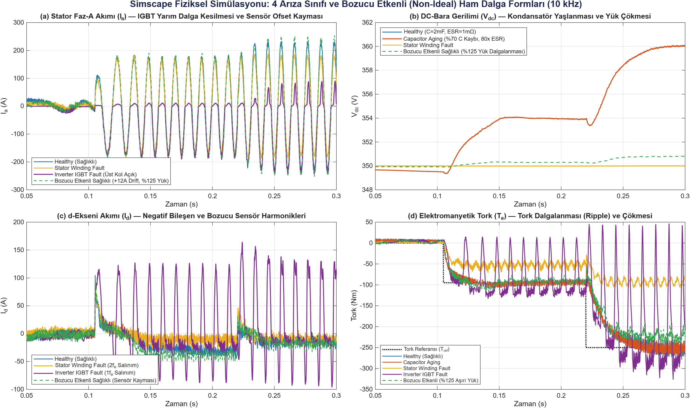 | 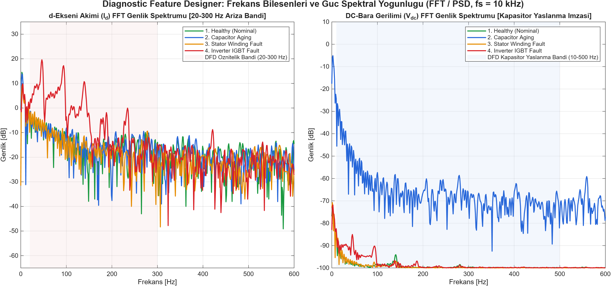 |

### 2.4. 480 Üyeli Bozucu Etkenli Veri Kümesi ve `Diagnostic Feature Designer` Analizi
Sınıflandırıcının ezber yapmasını önlemek ve saha koşullarını yansıtmak amacıyla her sınıftan `120` üye olmak üzere toplam **480 üyeli (`12,960,000` veri noktalı)** veri kümesi üretilmiştir. Veri kümesine **6 bozucu etken** (sensör DC kayması, kanal kalibrasyon sapması, aşırı yük/hız değişimleri, rejeneratif bara çökmeleri, renkli EMI gürültüsü ve %18–%140 arası değişen arıza şiddetleri) dahil edilmiştir.


| Bozucu Etkenler Altında 480 Üyenin Histogram Örtüşmeleri | Öznitelik Sıralaması (ANOVA F-Skoru / Kruskal-Wallis / MRMR) |
| :---: | :---: |
|  |  |

### 2.5. Classification Learner (35 Model) Başarımı ve Zamansal Yumuşak Oylama (Soft-Voting)
480 bozucu etkenli ensemble üyesi üzerinde **Classification Learner ("All" — 35 Model)** ve komut satırı modelleri ile gerçekleştirilen **5-Katlı Çapraz Doğrulama (5-Fold Cross-Validation)** sonuçları:

| Sıra | Sınıflandırma Modeli | Öznitelik Seti | Doğru Tahmin (`480` Üye) | 5-Katlı Çapraz Doğrulama Başarımı (%) |
| :---: | :--- | :---: | :---: | :---: |
| **1** | **Wide Neural Network (`Model 1.31`)** | En İyi 12 Öznitelik | `468 / 480` | **%97.50** |
| **2** | **Quadratic Discriminant (`Model 1.6`)** | Tüm 20 Öznitelik | `466 / 480` | **%97.08** |
| **3** | **Narrow Neural Network (`Model 1.29`)** | En İyi 12 Öznitelik | `464 / 480` | **%96.67** |
| **4** | **Residual Neural Network / DL (`Model 1.34`)** | En İyi 12 Öznitelik | `464 / 480` | **%96.67** |
| **5** | **Bagged Trees / Random Forest (`Model 1.25`)** | En İyi 12 Öznitelik | `461 / 480` | **%96.04** |
| **6** | **Komut Satırı Random Forest (`Mdl_RandomForest`, 80 Ağaç)** | En İyi 12 Öznitelik | `453 / 480` | **%94.37** |
| **7** | **Multi-Class ECOC Gaussian SVM (`Mdl_MultiSVM`)** | En İyi 12 Öznitelik | `428 / 480` | **%89.17** |

| 5-Katlı Çapraz Doğrulama Karmaşıklık Matrisi (Confusion Matrix) | Canlı Kestirimci Bakım Senaryosu (Ham Çıkış vs. 3-Pencereli Soft-Voting Filtresi) |
| :---: | :---: |
| 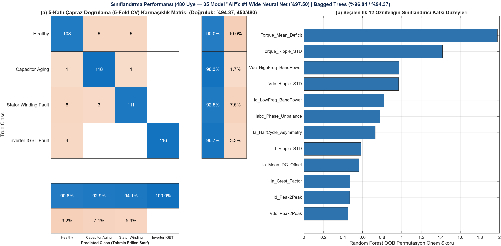 | 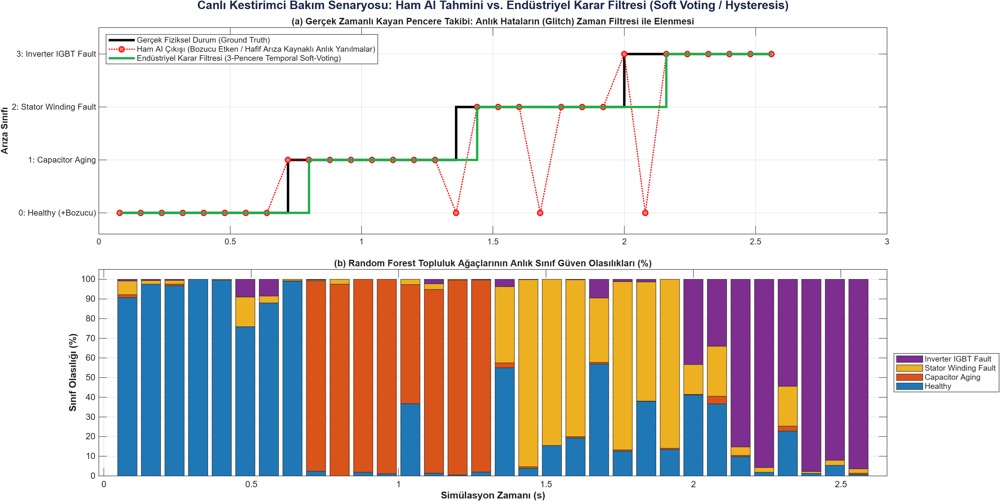 |

---

## Gereksinimler

- **MATLAB** (R2024a veya üzeri; R2026a ile test edilmiştir)
- **Simulink** ve **Simscape Electrical**
- **Stateflow**
- **Deep Learning Toolbox**
- **Statistics and Machine Learning Toolbox**
- **Predictive Maintenance Toolbox** ve **Signal Processing Toolbox**

---

## Referans

- MathWorks Simscape Electrical Documentation, *"Synchronous Machine Torque Control"*:  
  [https://www.mathworks.com/help/simscape-electrical/ug/sm-torque-control.html](https://www.mathworks.com/help/simscape-electrical/ug/sm-torque-control.html)

---

## Lisans

Bu proje [MIT Lisansı](LICENSE) altında lisanslanmıştır.
