# ⚡ Yapay Zeka Destekli Senkron Makine Tork Kontrolü (DNN-1 & DNN-2) ve Kestirimci Bakım / Arıza Teşhisi (PdM)


Bu proje, **65 kW Çıkık Kutuplu Senkron Makine (Salient-Pole Synchronous Machine)** elektrikli çekiş sürücüsü için uçtan uca geliştirilmiş iki ana mühendislik modülünden oluşmaktadır:

1. **Bölüm 1 — %100 Yapay Zeka Tabanlı Kaskad Tork ve Akım Kontrolü (`Bolum1_YapayZeka_TorkKontrolu/`):**  
   Klasik sürücüdeki *3-Boyutlu Lookup Table* (Dış Döngü) ve *3 adet PI Kontrolcü* (İç Döngü) tamamen kaldırılarak yerine **Fizik-Destekli Derin Karar Ağı (`DNN-1`)** ve **PI'sız MIMO Derin Akım Kontrol Ağı (`DNN-2`)** yerleştirilmiştir. Çıkık kutuplu makinedeki relüktans tork kaybı ($(L_d - L_q) i_d i_q$) telafi edilerek referans tork takip hatası (MAE) **%91.61 oranında azaltılmıştır** (`40.42 Nm` $\rightarrow$ `3.39 Nm`).
2. **Bölüm 2 — 4-Sınıflı Fiziksel Arıza Enjeksiyonu, Bozucu Etken Analizi ve Kestirimci Bakım (`Bolum2_KestirimciBakim_ArizaTeshisi/`):**  
   %100 yapay zeka ile sürülen kapalı-çevrim model üzerine **DC-Bara Kapasitör Yaşlanması**, **Stator Sargı/İzolasyon Arızası** ve **İnverter IGBT Açık Devre Arızası** ile **6 endüstriyel bozucu etken** (Hall-effect sensör DC ofset kayması, kanal kazanç kalibrasyon hatası, %125 aşırı yük darbeleri, rejeneratif kıyıcı çökmeleri, renkli EMI gürültüsü ve erken evre başlangıç arızaları) fiziksel olarak modellenmiştir. **Classification Learner ("All" — 35 Model)** üzerinde eğitilen modellerde **%97.50 (`468 / 480` doğru — Wide Neural Network)** çapraz doğrulama başarımı elde edilmiştir. Simulink modelinin üst şeridine eklenen **5 adet canlı etkileşimli arıza seçim butonu** ile simülasyon çalışırken tek tıkla arıza modları değiştirilebilmektedir.

---

## 🧭 Sistem Mimarisi ve İş Akışı Diyagramları

### 1. Bölüm 1: %100 Yapay Zeka Kaskad Sürücü Mimarisi (`SMTorqueControl_AI.slx`)

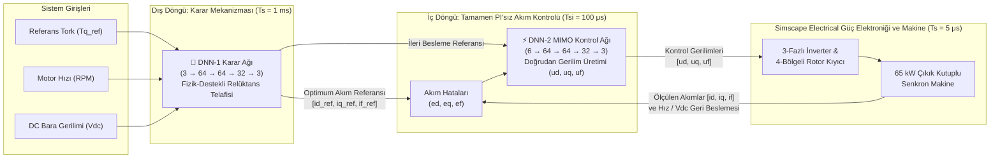

### 2. Bölüm 2: 4-Sınıflı Kestirimci Bakım ve Çoklu Model Sınıflandırma Hattı (`SMTorqueControl_PdM.slx`)

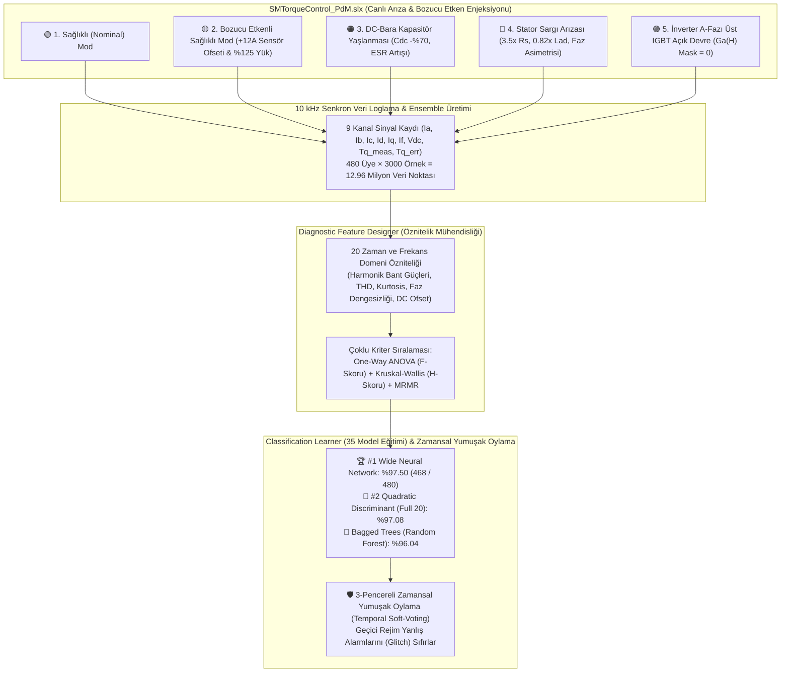

---

## 📂 Modüler Klasör Yapısı

Proje, her bir bölümün kendi içerisinde tamamen bağımsız çalışabileceği (**self-contained**) ve kök dizindeki `startup.m` ile tek komutta tüm yolların tanımlanabileceği modüler Türkçe klasör mimarisine sahiptir:

```text
SMTorqueControlExample/
├── README.md                                              # Proje ana dokümantasyonu ve görsel vitrin
├── startup.m                                              # Tek komutla tüm yolları (Path) ve tabloları yükleyen başlatıcı
├── Arayuzler_Icin_Hizli_Baslatici.mlx                     # DFD, Classification Learner (35 Model) ve Deep Network Designer hızlı başlatıcı
├── LICENSE                                                # MIT Lisansı
├── .gitignore                                             # MATLAB/Simulink önbellek ve büyük dosya kuralları
│
├── Ortak_Veri_ve_Parametreler/                            # Her iki bölümün kullandığı ortak makine ve referans verileri
│   ├── SMTorqueControlData.m                              # 65 kW Senkron Makine, batarya, PI ve yol (Path) başlatma betiği
│   ├── SM65kWCurrentReferences.mat                        # 3-Boyutlu klasik akım referans haritaları (7×101×6)
│   ├── SMTorqueControlLoadRPM.mat                         # Senkron makine hız (RPM) profili zaman serisi
│   └── SMTorqueControlTorqueRequest.mat                   # Referans tork basamakları (Motor & Jeneratör rejimi)
│
├── Bolum1_YapayZeka_TorkKontrolu/                         # BÖLÜM 1: %100 Yapay Zeka (DNN-1 + DNN-2) Tork Kontrolü
│   ├── YapayZeka_TorkKontrolu_AdimAdim_Rehber.mlx         # Adım adım etkileşimli MATLAB Live Script mühendislik rehberi
│   ├── YapayZeka_TorkKontrolu_AdimAdim_Rehber.html        # Tarayıcıda doğrudan görüntülenebilir HTML rapor çıktısı
│   ├── SMTorqueControl.slx                                # Orijinal klasik model (3B Lookup Table + 3x PI Kontrolcü)
│   ├── SMTorqueControl_AI.slx                             # %100 Yapay Zeka modeli (DNN-1 Karar Ağı + DNN-2 Akım Kontrol Ağı)
│   ├── Mat_Dosyalari/                                     # Bölüm 1 eğitilmiş derin ağ ağırlıkları ve simülasyon sonuçları
│   │   ├── DNN1_DecisionNet.mat                           # Eğitilmiş dış döngü derin karar ağı (dlnetwork, 29 KB)
│   │   ├── DNN2_ControllerNet.mat                         # Eğitilmiş iç döngü PI'sız MIMO kontrol ağı (dlnetwork, 30 KB)
│   │   ├── DNN2_Training_Data.mat                         # İç döngü durum uzayı eğitim verisi (493 KB)
│   │   ├── Classic_Baseline_Results.mat                   # Klasik model 1.0 s simülasyon sonuçları (868 KB)
│   │   └── AI_Simulation_Results.mat                      # %100 AI model 1.0 s simülasyon sonuçları (5.66 MB)
│   └── Gorseller/                                         # Bölüm 1 işaretli Simulink şemaları ve doğrulama grafikleri (12 PNG)
│
└── Bolum2_KestirimciBakim_ArizaTeshisi/                   # BÖLÜM 2: 4-Sınıflı Kestirimci Bakım ve Arıza Teşhisi (PdM)
    ├── KestirimciBakim_ArizaTeshisi_AdimAdim_Rehber.mlx   # Adım adım etkileşimli Kestirimci Bakım Live Script rehberi
    ├── KestirimciBakim_ArizaTeshisi_AdimAdim_Rehber.html  # Tarayıcıda doğrudan görüntülenebilir HTML rapor çıktısı
    ├── Arayuzler_Icin_Hizli_Baslatici.mlx                 # Canlı demo arayüzlerini (35 Model hazır) tek tıkla açan başlatıcı
    ├── SMTorqueControl_PdM.slx                            # 5 canlı arıza seçim butonlu ve bozucu etkenli PdM Simulink modeli
    ├── Mat_Dosyalari/                                     # Bölüm 2 arıza veri kümeleri, öznitelik tabloları ve sınıflandırıcılar
    │   ├── PdM_4Class_RawWaveforms.mat                    # 4 arıza sınıfı + bozucu etkenli kapalı-çevrim dalga formları (2.42 MB)
    │   ├── PdM_ClassificationLearner_Oturumu.mat          # Classification Learner "All" (35 Model Hazır — #1 Wide NN %97.5) oturumu (4.02 MB)
    │   ├── PdM_Trained_Classifier.mat                     # Eğitilmiş Random Forest, Multi-SVM ve 480 üyeli öznitelik tabloları (740 KB)
    │   ├── PdM_ClassificationLearner_Full20_Oturumu.mat   # [Opsiyonel/LFS] Tüm 20 öznitelikli 35-Model CL oturumu (40.9 MB)
    │   ├── PdM_Diagnostic_Ensemble.mat                    # [Opsiyonel/LFS] 480 üyeli (12.96M noktalı) ham timetable kümesi (56.4 MB)
    │   └── PdM_DFD_Oturumu.mldatx                         # [Opsiyonel/LFS] Kaydedilmiş canlı Diagnostic Feature Designer oturumu (186.6 MB)
    └── Gorseller/                                         # Bölüm 2 Simulink arıza blokları, PSD, DFD ve teşhis grafikleri (11 PNG)
```

---

## 🚀 Hızlı Başlangıç (Quick Start)

### 1. Projeyi Başlatma
Projeyi bilgisayarınıza klonladıktan sonra MATLAB'da proje kök dizinine gelip tek satırla başlatıcıyı çalıştırın:

```matlab
startup
```

`startup.m` betiği çalıştığında:
- `Ortak_Veri_ve_Parametreler`, `Bolum1_YapayZeka_TorkKontrolu` ve `Bolum2_KestirimciBakim_ArizaTeshisi` alt klasörlerini otomatik olarak MATLAB yoluna (`path`) ekler,
- 65 kW senkron makine parametrelerini ve kestirimci bakım öznitelik tablolarını (`PdM_ClassificationLearner_Top12Table` vb.) çalışma uzayına (`Base Workspace`) yükler,
- Komut penceresinde tüm `.mlx` rehberlerini, `.slx` modellerini ve `Classification Learner` oturumunu tek tıkla açabileceğiniz etkileşimli bağlantılar sunar.

### 2. Etkileşimli Mühendislik Rehberlerini ve Arayüz Başlatıcıyı (`.mlx`) Açma

```matlab
% Canlı Sunum & Demo Arayüz Başlatıcısı (DFD + Classification Learner 35 Model + Deep Network Designer)
edit('Arayuzler_Icin_Hizli_Baslatici.mlx')

% Bölüm 1: %100 Yapay Zeka Tork Kontrolü Adım Adım Rehberi
edit('YapayZeka_TorkKontrolu_AdimAdim_Rehber.mlx')

% Bölüm 2: 4-Sınıflı Kestirimci Bakım ve Arıza Teşhisi Adım Adım Rehberi
edit('KestirimciBakim_ArizaTeshisi_AdimAdim_Rehber.mlx')
```

### 3. Hazır Eğitilmiş 35 Modelli `Classification Learner` Oturumunu Doğrudan Açma

```matlab
% Veri seçme ekranı çıkmadan, eğitilmiş 35 modelin tamamını (#1 Wide Neural Network: %97.50) hazır aç:
classificationLearner(which('PdM_ClassificationLearner_Oturumu.mat'))
```

> [!NOTE]
> **Büyük Dosya (`>40 MB`) ve Hafif Kurulum Bilgilendirmesi:**  
> GitHub'ın dosya boyutu sınırları nedeniyle `PdM_DFD_Oturumu.mldatx` (`186.6 MB`), `PdM_Diagnostic_Ensemble.mat` (`56.4 MB`) ve `PdM_ClassificationLearner_Full20_Oturumu.mat` (`40.9 MB`) `.gitignore` dosyasında hariç tutulmuştur. Ancak **tüm eğitilmiş derin ağlar (`DNN1`, `DNN2`), 35 modelin tamamını içeren `PdM_ClassificationLearner_Oturumu.mat` (`4.02 MB`), sınıflandırıcılar (`Mdl_RandomForest`, `Mdl_MultiSVM`) ve 480 üyeli öznitelik tabloları (`PdM_Feature_Table`, `PdM_ClassificationLearner_Top12Table`, `Feature_Ranking_Table`) doğrudan Git deposunda yer almaktadır!**

---

## 🧠 BÖLÜM 1: %100 Yapay Zeka Tabanlı Tork ve Akım Kontrolü (`Bolum1_YapayZeka_TorkKontrolu/`)

### 1.1. Mühendislik Problemi: Çıkık Kutuplu Senkron Makinede Relüktans Tork Kaybı
65 kW çıkık kutuplu senkron makinede d-ekseni senkron endüktansı ($L_d = 1.05\ \mathrm{pu}$), q-ekseni endüktansından ($L_q = 0.70\ \mathrm{pu}$) büyüktür. Elektromanyetik tork denklemi:

$$T_e = \left(i_f + (L_d - L_q)\,i_d\right) i_q$$

Orijinal klasik modeldeki (`SMTorqueControl.slx`) 3-boyutlu Lookup Table blokları, alan zayıflatma bölgesindeki negatif $i_d$ akımının yarattığı relüktans tork kaybını ($(L_d - L_q)i_d i_q$) telafi etmediği için yüksek tork basamaklarında **53.19 Nm kalıcı tork sapması** oluşmaktadır.


### 1.2. Dış Döngü Dönüşümü: 3B Lookup Table Yerine Fizik-Destekli `DNN-1` Karar Ağı
Klasik dış döngüdeki 3 adet 3-Boyutlu Lookup Table bloğu tamamen silinmiş; motorun $7 \times 101 \times 6 = 4242$ çalışma noktasında relüktans tork denklemini sağlayan fizik-destekli (physics-informed) akım referanslarıyla eğitilen **`DNN-1` (`3 → 64 → 64 → 32 → 3`)** derin sinir ağı yerleştirilmiştir:

| Dış Döngü (ÖNCE — Klasik 3B Lookup Table) | Dış Döngü (SONRA — `DNN1_Karar_Agi`) |
| :---: | :---: |
|  |  |

| 3B Fizik-Destekli Optimum Akım Haritaları | `DNN-1` Doğrulama Başarımı ($R^2 > 0.999$) |
| :---: | :---: |
| 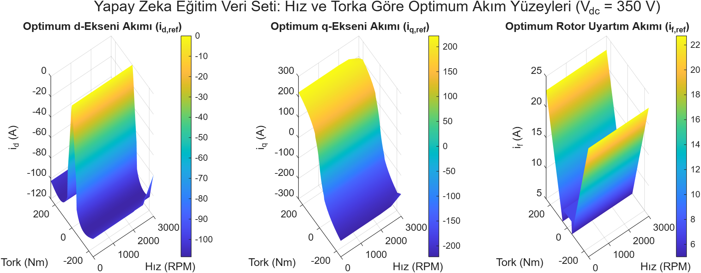 | 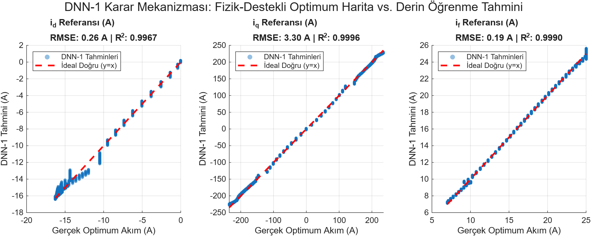 |

### 1.3. İç Döngü Dönüşümü: 3x PI Kontrolcü Yerine Tamamen PI'sız MIMO `DNN-2` Kontrol Ağı
İç döngüdeki (`SM Current Controller`) `PI id`, `Pi iq`, `Pi if` kontrolcüleri ve anti-windup geri besleme blokları tamamen kaldırılmış; 3 eksen akım hatası ($e_d, e_q, e_f$) ile 3 eksen referans akımını ($i_{d,\mathrm{ref}}, i_{q,\mathrm{ref}}, i_{f,\mathrm{ref}}$) alıp doğrudan kontrol gerilimlerini ($u_d, u_q, u_f$) üreten **`DNN-2` (`6 → 64 → 64 → 32 → 3`)** MIMO derin kontrol ağı bağlanmıştır:

| İç Döngü (ÖNCE — 3 Adet Klasik PI Kontrolcü) | İç Döngü (SONRA — Tamamen PI'sız `DNN2_Akilli_Kontrol_Agi`) |
| :---: | :---: |
| 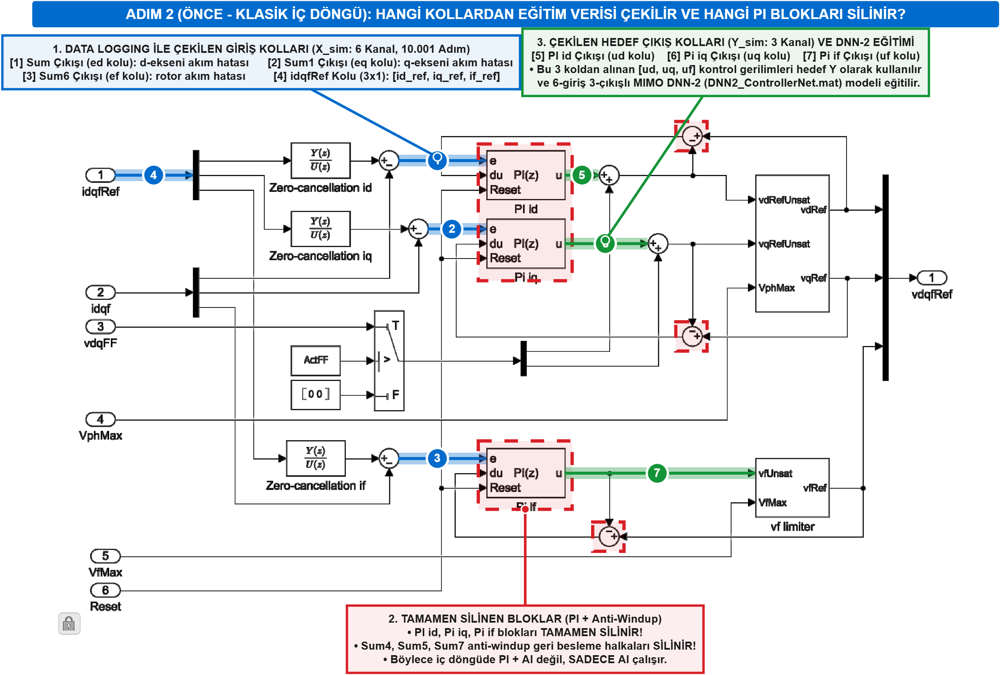 | 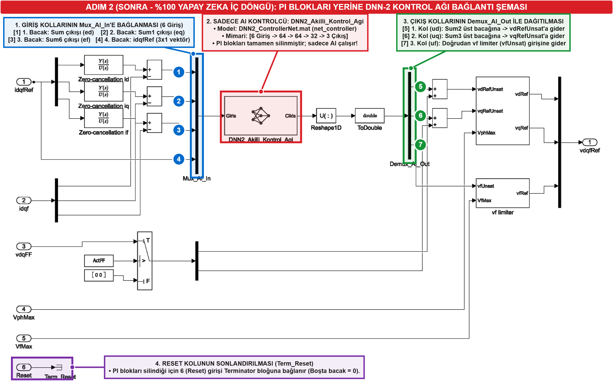 |

| `DNN-2` Durum Uzayı Eğitim Verisi | `DNN-2` Gerilim Tahmin Doğrulaması |
| :---: | :---: |
| 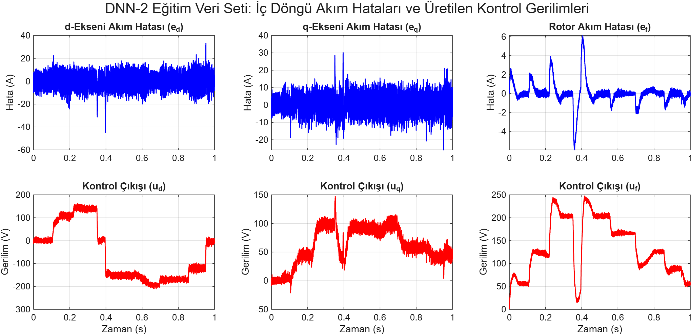 |  |

### 1.4. Kapalı-Çevrim Performans Karşılaştırması (Klasik vs. %100 Yapay Zeka)

| Kontrol Mimarisi | Dış Döngü ($T_s = 1\ \mathrm{ms}$) | İç Döngü ($T_{si} = 100\ \mu\mathrm{s}$) | RMSE Tork Sapması (Nm) | MAE Tork Sapması (Nm) | Net Hata Azaltımı (%) |
| :--- | :--- | :--- | :---: | :---: | :---: |
| **Klasik Kontrol (`SMTorqueControl.slx`)** | 3x 3B Lookup Table | 3x PI Kontrolcü + Anti-Windup | `46.51 Nm` | `40.42 Nm` | Referans |
| **%100 Yapay Zeka (`SMTorqueControl_AI.slx`)** | **DNN-1 Karar Ağı** | **DNN-2 MIMO Kontrol Ağı (PI'sız)** | **`6.54 Nm`** | **`3.39 Nm`** | **%91.61 İyileşme** |

| 1.0 Saniyelik Kapalı-Çevrim Tork Takibi ve Sapma Analizi | Hata Metrikleri Karşılaştırması (RMSE & MAE) |
| :---: | :---: |
|  |  |

---

## 🛠️ BÖLÜM 2: 4-Sınıflı Kestirimci Bakım ve Arıza Teşhisi (`Bolum2_KestirimciBakim_ArizaTeshisi/`)

### 2.1. Simulink Üzerinde 5 Canlı Etkileşimli Arıza Seçim Butonu (`SMTorqueControl_PdM.slx`)
`SMTorqueControl_PdM.slx` modelinin en üst şeridine, simülasyon **başlamadan önce** veya **simülasyon çalışırken canlı (live) olarak** çift tıklayıp arıza/bozucu modunu anında değiştirebileceğiniz **5 adet renkli etkileşimli buton** ve **1 adet Aktif Mod Göstergesi** eklenmiştir:

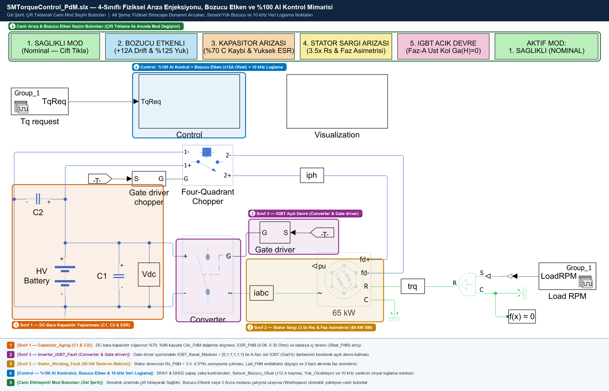

| Simulink Butonu | Arıza / Çalışma Sınıfı | Atanan Fiziksel Parametreler | Fiziksel Etki ve Sinyal İmzası |
| :--- | :--- | :--- | :--- |
| 🟢 **1. SAĞLIKLI MOD** | `Healthy` (Nominal) | `Cdc_PdM = 1 mF`, `ESR = 0.1 mΩ`, `Rs_PdM = Rs`, `Gate_Mask = [1;1;1;1;1;1]` | Dengeli 3-faz stator akımı, sabit $350\ \mathrm{V}$ DC-bara, sıfır faz asimetrisi |
| 🟡 **2. BOZUCU ETKENLİ** | `Healthy` (+Ağır Bozucu) | `Sensor_Offset = [+12;-6;-6] A`, `Unbalance = [1.04;0.98;0.98]`, `Load = 1.25x` | Hall-effect sensör DC sıfır kayması ve %125 aşırı yük darbesi altında sağlam sistem testi |
| 🟠 **3. KAPASİTÖR ARIZASI** | `Capacitor_Aging` | `Cdc_PdM = 0.30*Cdc`, `ESR_PdM = 0.08 Ω`, `Rbat_PdM = 0.18 Ω` | Tork basamaklarında şiddetli $V_{dc}$ dalgalanması (`129.6 V` p-p) ve $10\text{--}500\ \mathrm{Hz}$ bant gücü artışı |
| 🔴 **4. STATOR SARGI ARIZASI** | `Stator_Winding_Fault` | `Rs_PdM = 3.5*Rs`, `Lad_PdM = 0.82*Lad`, `Unbalance = [1.12;0.94;0.94]` | Fazlar arası `%17.5` akım dengesizliği, $2\times f_e$ negatif bileşen salınımı ve tork düşümü |
| 🟣 **5. IGBT AÇIK DEVRE** | `Inverter_IGBT_Fault` | `Gate_Fault_Mask = [0;1;1;1;1;1]` (A-Fazı Üst IGBT `Ga(H)` kesik) | $I_a$ pozitif alternans çökmesi (`-33.2 A` DC kayma), `%30.8` faz dengesizliği ve $1\times f_e$ harmonik tepe |

### 2.2. Fiziksel Arıza Enjektörü ve 10 kHz Sabit Adımlı Veri Loglama Alt Sistemleri

| İnverter IGBT Açık Devre Kapı Maskeleme Alt Sistemi | Stator Faz Asimetrisi, Sensör Bozucu Ofset ve 10 kHz Veri Loglama |
| :---: | :---: |
| 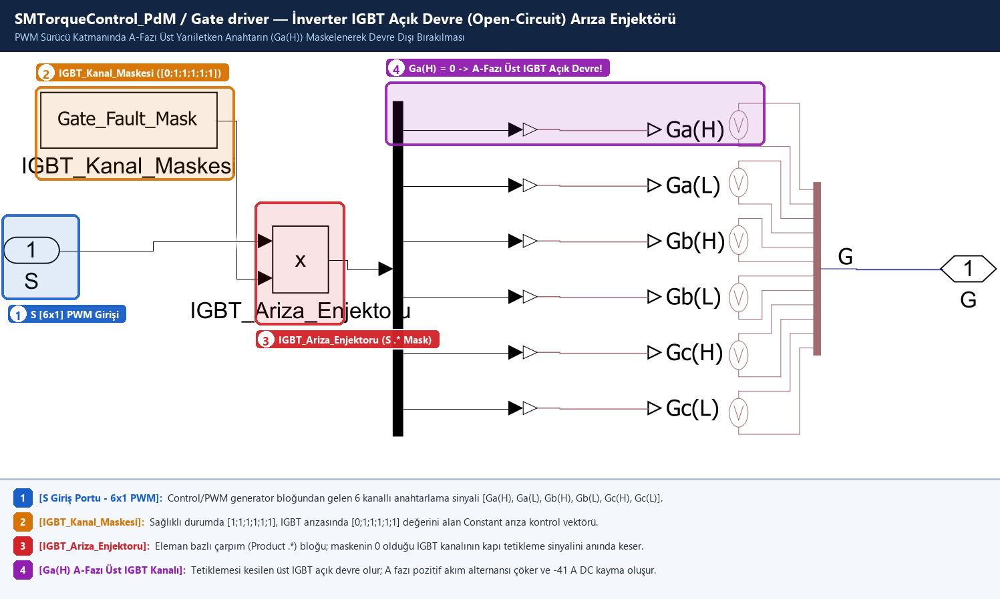 | 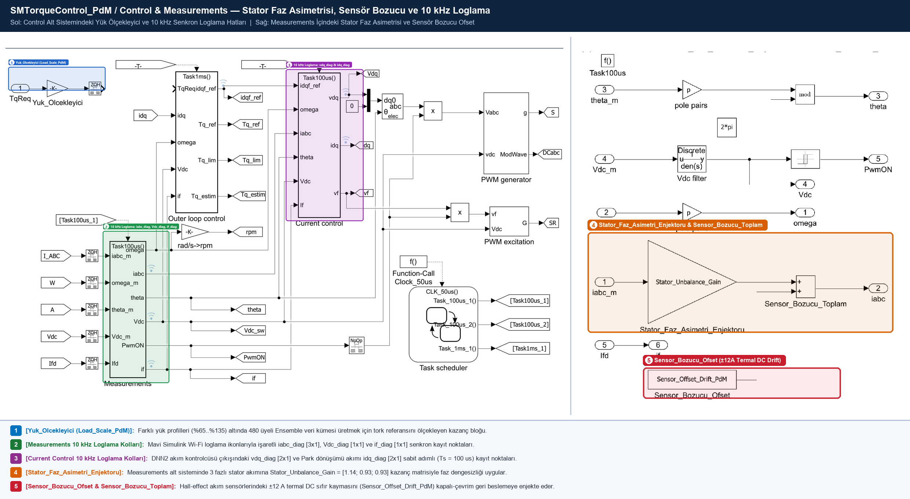 |

### 2.3. 4 Arıza Sınıfının Kapalı-Çevrim Dalga Formları ve Frekans Spektrumu (PSD)

| 4 Sınıf + Bozucu Etkenli Rejim Ham Dalga Formları | d-Ekseni Akımı ($I_d$) ve DC-Bara ($V_{dc}$) Güç Spektral Yoğunluğu (PSD) |
| :---: | :---: |
|  |  |

### 2.4. 480 Üyeli Bozucu Etkenli Veri Kümesi ve `Diagnostic Feature Designer` Analizi
Sınıflandırıcının ezber yapmasını önlemek ve gerçek endüstriyel saha koşullarını yansıtmak amacıyla her sınıftan `120` üye olmak üzere toplam **480 üyeli (`12,960,000` veri noktalı)** ideal olmayan (`non-ideal`) veri kümesi üretilmiştir. Veri kümesine **6 gerçekçi bozucu etken** (sensör DC kayması, kanal kalibrasyon sapması, aşırı yük/hız değişimleri, rejeneratif bara çökmeleri, renkli EMI gürültüsü ve %18–%140 arası değişen başlangıç/ileri seviye arıza şiddetleri) dahil edilmiştir.

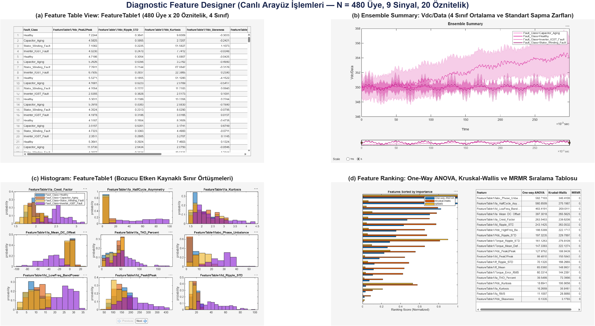

| Bozucu Etkenler Altında 480 Üyenin Histogram Örtüşmeleri | Çoklu Kriter Öznitelik Sıralaması (ANOVA F-Skoru / Kruskal-Wallis / MRMR) |
| :---: | :---: |
| 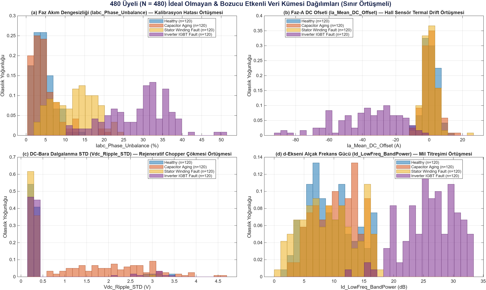 | 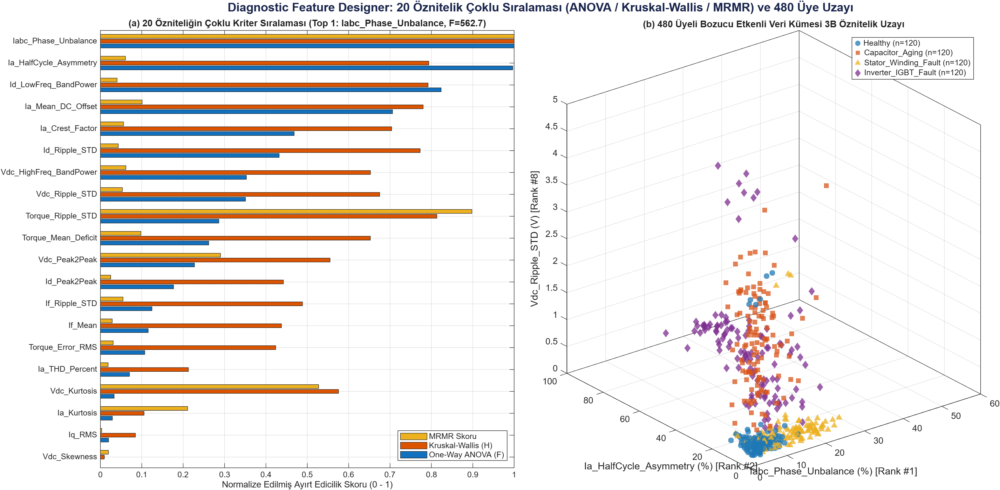 |

### 2.5. Classification Learner (35 Model) Başarımı ve 3-Pencereli Zamansal Yumuşak Oylama (Soft-Voting)
480 bozucu etkenli ensemble üyesi üzerinde **Classification Learner ("All" — 35 Model)** ve komut satırı modelleri ile gerçekleştirilen **5-Katlı Çapraz Doğrulama (5-Fold Cross-Validation)** sonuçları:

| Sıra | Sınıflandırma Modeli | Öznitelik Seti | Doğru Tahmin (`480` Üye) | 5-Katlı Çapraz Doğrulama Başarımı (%) |
| :---: | :--- | :---: | :---: | :---: |
| **#1** | **Wide Neural Network (`Model 1.31`)** | En İyi 12 Öznitelik | `468 / 480` | **%97.50** |
| **#2** | **Quadratic Discriminant (`Model 1.6`)** | Tüm 20 Öznitelik | `466 / 480` | **%97.08** |
| **#3** | **Narrow Neural Network (`Model 1.29`)** | En İyi 12 Öznitelik | `464 / 480` | **%96.67** |
| **#4** | **Residual Neural Network / DL (`Model 1.34`)** | En İyi 12 Öznitelik | `464 / 480` | **%96.67** |
| **#5** | **Bagged Trees / Random Forest (`Model 1.25`)** | En İyi 12 Öznitelik | `461 / 480` | **%96.04** |
| **#6** | **Komut Satırı Random Forest (`Mdl_RandomForest`, 80 Ağaç)** | En İyi 12 Öznitelik | `453 / 480` | **%94.37** |
| **#7** | **Multi-Class ECOC Gaussian SVM (`Mdl_MultiSVM`)** | En İyi 12 Öznitelik | `428 / 480` | **%89.17** |

| 5-Katlı Çapraz Doğrulama Karmaşıklık Matrisi (Confusion Matrix) | Canlı Kestirimci Bakım Senaryosu (Ham Çıkış vs. 3-Pencereli Soft-Voting Filtresi) |
| :---: | :---: |
|  |  |

---

## 🛠️ Gereksinimler (Requirements)

- **MATLAB** (R2024a veya üzeri; R2026a ile test edilmiştir)
- **Simulink** & **Simscape Electrical** (Fiziksel senkron makine, inverter ve arıza enjeksiyon modelleri için)
- **Stateflow** (Görev zamanlayıcı durum makinesi için)
- **Deep Learning Toolbox** (`DNN-1` ve `DNN-2` `dlnetwork` modelleri için)
- **Statistics and Machine Learning Toolbox** (`TreeBagger`, `fitcecoc` ve `Classification Learner` için)
- **Predictive Maintenance Toolbox** & **Signal Processing Toolbox** (`Diagnostic Feature Designer` ve spektral analiz için)

---

## 📄 Lisans

Bu proje [MIT Lisansı](LICENSE) altında lisanslanmıştır.
